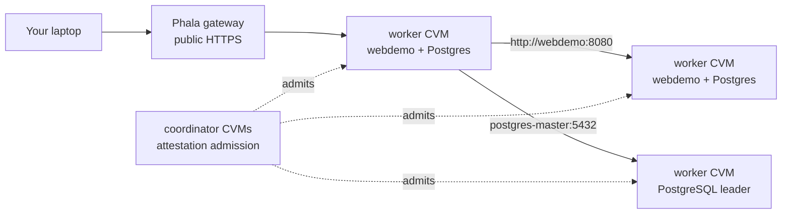
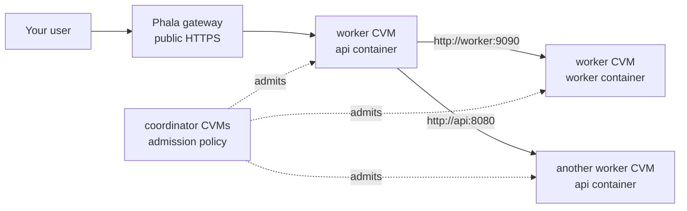

# service-mesh

Build an attested cluster, not just one attested VM.

If you can already deploy one dstack Confidential VM (CVM) on Phala
Cloud, the next question is: how do you run a real application made of
several CVMs, while still knowing that every machine belongs to the
deployment?

This repository is a working template for that problem. It deploys a
multi-CVM application where each node must prove its attestation
evidence before it receives credentials to join the service layer. Once
admitted, workloads call each other by normal service names.

The demo application is HA PostgreSQL plus a small web service. The
pattern is the important part: define the cluster, deploy it, verify the
running services, then replace the demo workload with your own.

## What You Get

The example deploys:

- multiple Phala Cloud CVMs managed as one application cluster,
- private service-to-service traffic between those CVMs,
- attestation-based admission for cluster members,
- stable service names such as `postgres-master` and `webdemo`,
- a public URL you can use to verify the deployment from your laptop.

You do not need to understand the internal networking stack to use the
template.

## Try The Demo

You need:

- a Phala Cloud account,
- a Phala Cloud API key,
- Terraform.

```bash
git clone https://github.com/Dstack-TEE/service-mesh.git
cd service-mesh/cluster-example
cp terraform.tfvars.example terraform.tfvars
```

For the default demo environment, `terraform.tfvars.example` is already
filled in. Before applying, make sure the three image values point to
public container images that Phala Cloud can pull. The example uses the
release image names; if your deployment sees a registry authorization
error, replace them with public image tags from your build.

Open `terraform.tfvars` only if your Phala Cloud environment uses a
different gateway domain or you want to run custom images.

The gateway domain is the suffix used by Phala app URLs, for example:

```text
https://<app-id>-8080.dstack-pha-prod5.phala.network
                         ^^^^^^^^^^^^^^^^^^^^^^^^^^^^^
                         gateway_domain
```

Deploy:

```bash
export PHALA_CLOUD_API_KEY=phak_...
terraform init -upgrade
terraform apply
```

Every node is admitted through attestation before it receives service
credentials.

## Verify It Works

After deployment, Terraform prints `webdemo_url`. Use it from your
laptop:

```bash
WEB=$(terraform output -raw webdemo_url)
echo "$WEB"
curl "$WEB/hello"
```

The URL has the same shape as other Phala gateway URLs:

```text
https://<worker-app-id>-8080.dstack-pha-prod5.phala.network
```

`/hello` should return one worker identity:

```text
hello from worker-3
```

Now ask that service to call other demo instances through the private
cluster network:

```bash
curl "$WEB/all"
```

The response is JSON. The exact worker names can differ, but the shape
should look like this:

```json
{
  "from": "worker-3",
  "results": {
    "hello from worker-3": 2,
    "hello from worker-4": 3,
    "hello from worker-5": 3
  },
  "samples": 8
}
```

Seeing more than one worker in `results` proves the important path:

- your request reached the deployed app,
- one workload called another workload by service name,
- the call stayed on the private cluster network,
- the responding workload had been admitted into the cluster.

## What App Code Looks Like

The demo deploys a public web service plus a private PostgreSQL service:



Inside the cluster, application code calls service names:

```text
http://webdemo:8080
postgres-master:5432
postgres-replica:5432
```

Your app does not need to know which CVM currently hosts a service. In
the PostgreSQL demo, `postgres-master` follows the current leader and
`postgres-replica` reaches read replicas. After failover, clients keep
using the same names.

## Define Your Own Service Mesh

To replace the demo with your own application, decide which containers
run in each worker CVM and which names they should use to call each
other.

For example, this application has a public API and a private worker:



Declare the callable service names in `cluster-example/cluster.tf`:

```hcl
locals {
  mesh_services = [
    { name = "api",    port = 8080 },
    { name = "worker", port = 9090 },
  ]
}
```

Run those containers in `compose/worker.yaml` beside the existing
`sidecar` service:

```yaml
services:
  api:
    image: ghcr.io/you/api@sha256:...
    network_mode: host
    restart: unless-stopped
    entrypoint: ["/bin/sh", "-c"]
    command:
      - |
        set -e
        cat /run/mesh/hosts >> /etc/hosts
        exec /app/api
    volumes:
      - /tmp/dstack-runtime/mesh:/run/mesh:ro
    depends_on:
      sidecar:
        condition: service_healthy

  worker:
    image: ghcr.io/you/worker@sha256:...
    network_mode: host
    restart: unless-stopped
    entrypoint: ["/bin/sh", "-c"]
    command:
      - |
        set -e
        cat /run/mesh/hosts >> /etc/hosts
        exec /app/worker
    volumes:
      - /tmp/dstack-runtime/mesh:/run/mesh:ro
    depends_on:
      sidecar:
        condition: service_healthy
```

After deployment, code in either container can call:

```text
http://api:8080
http://worker:9090
```

The sidecar writes `/run/mesh/hosts` from `mesh_services`; app
containers append it before starting so those names resolve inside each
container.

For a port listed in `mesh_services`, avoid binding `0.0.0.0:<port>`.
That also captures the local mesh address for the same port. Bind
`127.0.0.1:<port>` for mesh traffic; if the same service is public
through the Phala gateway, also bind the host interface address. The
demo [`webdemo`](webdemo/main.go) shows that dual-bind pattern.

The PostgreSQL demo uses one advanced option: several public names can
point at one backend. That is how clients get stable names for the
current leader and replicas:

```hcl
locals {
  mesh_services = [
    {
      name             = "postgres-master"
      port             = 5432
      backend          = "postgres"
      role             = "master"
      workload         = "postgres"
      parent_service   = var.cluster_name
      registers_parent = false
      consul_permissions = {
        key_prefixes  = ["service/${var.cluster_name}"]
        session_write = true
      }
    },
    {
      name             = "postgres-replica"
      port             = 5432
      backend          = "postgres"
      role             = "replica"
      workload         = "postgres"
      parent_service   = var.cluster_name
      registers_parent = false
      consul_permissions = {
        key_prefixes  = ["service/${var.cluster_name}"]
        session_write = true
      }
    },
  ]
}
```

You only need the advanced fields when the application owns its own
service registration or has role-based routing like Patroni. For normal
services, `name` and `port` are enough.

## What Is Verified

When a worker joins, it submits dstack evidence to the coordinator: the
part of the cluster that decides whether a node can receive service
identity. The coordinator checks that evidence against the policy
generated from the Terraform deployment definition.

The policy checks include:

- the TEE quote, which proves the CVM is running under the expected
  trusted execution environment,
- the claimed workload identity,
- the measured compose hash, which identifies the app definition dstack
  measured,
- the KMS identity, which identifies the key service used by the CVM,
- the claimed peer name.

If the evidence matches, the worker receives scoped service identity. If
it does not match, it cannot join the service layer.

See [`ATTESTATION.md`](ATTESTATION.md) for the exact evidence format and
verification flow.

## How It Works

The first-run path hides the internals, but the implementation uses
standard infrastructure:

- Terraform for deployment and policy rendering,
- Consul for membership and service catalog,
- Envoy for service-to-service mutual TLS,
- Patroni for PostgreSQL failover in the demo workload,
- dstack attestation and `dstack-verifier` for evidence checks,
- a small peer transport so CVMs can talk privately across the provider
  network.

Read [`ARCHITECTURE.md`](ARCHITECTURE.md) when you want the lower-level
design.

## Development

Validate Terraform:

```bash
terraform -chdir=cluster-example init -upgrade
terraform -chdir=cluster-example validate
```

Run local Go tests:

```bash
(cd admission-broker && go test ./...)
(cd signaling && go test ./...)
(cd webdemo && go test ./...)
```

Some modules use Go 1.24. Run them through Docker if your host Go is
older:

```bash
docker run --rm -v "$PWD:/src" -w /src/admission-client golang:1.24 go test ./...
docker run --rm -v "$PWD:/src" -w /src/bootstrap-secrets golang:1.24 go test ./...
docker run --rm -v "$PWD:/src" -w /src/mesh-conn golang:1.24 go test ./...
```

Build the sidecar image:

```bash
docker build -t service-mesh-mesh-sidecar-check -f mesh-sidecar/Dockerfile .
```

## More Docs

- [`ATTESTATION.md`](ATTESTATION.md): trust flow and evidence checks.
- [`ARCHITECTURE.md`](ARCHITECTURE.md): lower-level network and service
  design.
- [`FAILOVER.md`](FAILOVER.md): failover tests and measured recovery
  times.
- [`ROBUSTNESS.md`](ROBUSTNESS.md): failure modes and mitigations.
- [`PUBLISHING.md`](PUBLISHING.md): image publishing and provenance.
- [`PROGRESS.md`](PROGRESS.md): current status and remaining work.

## Current Limits

- The public connection-bootstrap endpoint is intended for demos and
  development. Production deployments should use a managed or
  tenant-owned endpoint.
- The current Terraform provider can add or remove instances without
  disturbing the rest of the cluster, but in-place workload updates are
  still waiting on cloud revision rollout support.
- Cluster-wide PostgreSQL and service-layer bootstrap secrets are still
  generated by Terraform and stored in the Terraform state file. The
  planned replacement is secret generation and distribution inside
  attested CVMs.
- Broker-issued service tokens are currently long-lived. Short TTLs need
  explicit renewal and reload paths.

## License

Apache-2.0. See [`LICENSE`](LICENSE).
