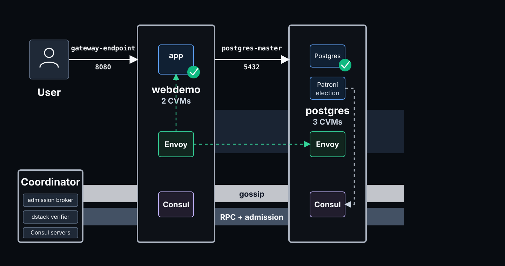
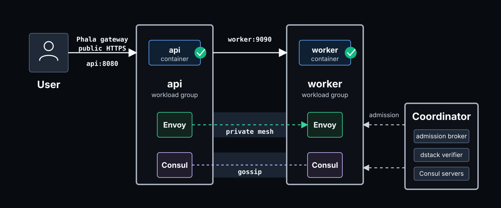

# service-mesh

Build an attested cluster, not just one attested VM.

`service-mesh` is a Terraform template for multi-CVM applications on
Phala Cloud. Each dstack Confidential VM (CVM) proves attestation
evidence before it receives private service credentials. After
admission, workloads call each other by stable service names such as
`webdemo`, `postgres-master`, or `worker`.

The default deployment runs a public web backend and private HA
PostgreSQL. Use it to learn the full flow. Then replace the demo
workload with your own services.

## When To Use This

Use this repository when:

- you can deploy dstack CVMs on Phala Cloud,
- you need several CVMs in one attested deployment,
- workloads should receive Consul and Envoy credentials only after
  attestation admission,
- application code should call private services by stable names.

This is not a Kubernetes service mesh. It is a Phala Cloud and dstack
template. It uses Terraform, Consul, Envoy, dstack attestation, and a
peer transport to run a private service layer across CVMs.

## What The HA Postgres Demo Deploys

The HA Postgres demo deploys:

- coordinator CVMs that run Consul servers and the admission broker,
- a public `webdemo` workload group,
- a private Patroni/PostgreSQL workload group,
- Consul and Envoy credentials that are issued after attestation
  admission,
- stable mesh names for app-to-app and app-to-database calls.



Inside the demo, workload code can call:

```text
http://webdemo:8080
postgres-master:5432
postgres-replica:5432
```

`postgres-master` follows the current Patroni leader.
`postgres-replica` reaches read replicas. After failover, clients keep
using the same names.

## Choose A Path

| Goal | Start here |
| --- | --- |
| Run the full HA Postgres demo | [Run The HA Postgres Demo](#run-the-ha-postgres-demo) |
| Copy the smallest custom mesh | [Create A Custom Mesh From The Starter](#create-a-custom-mesh-from-the-starter) |
| Learn the terms before editing HCL | [Core Concepts](#core-concepts) |
| Check the trust boundary | [What Is Verified](#what-is-verified) |
| Work on this repository | [Development](#development) |

## Requirements

This README assumes you can create dstack CVMs on Phala Cloud.

You need:

- a Phala Cloud account,
- a Phala Cloud API key,
- Terraform 1.5 or newer.

Phala Cloud must be able to pull each container image. The included
compose files use public images. Change images in the compose files,
not in `terraform.tfvars`. Pin images by digest when compose hashes are
part of an admission policy.

## Run The HA Postgres Demo

The HA Postgres demo exercises the public web path and private
service-to-service paths.

1. Clone the repository.

   ```bash
   git clone https://github.com/Dstack-TEE/service-mesh.git
   cd service-mesh/clusters/patroni-demo
   ```

2. Copy the example variables.

   ```bash
   cp terraform.tfvars.example terraform.tfvars
   ```

3. Edit `terraform.tfvars` if you need a different cluster name,
   replica count, STUN provider, KMS backend, attestation setting,
   or an explicit Phala Cloud `node_id` for pinned placement.

4. Set your Phala Cloud API key.

   ```bash
   export PHALA_CLOUD_API_KEY=phak_...
   ```

5. Deploy the cluster.

   ```bash
   terraform init
   terraform apply
   ```

> [!IMPORTANT]
> The local `mesh-coordinators` module keeps env values beside each named
> instance and handles identity allocation, broker URLs, and configuration.
> Independent boots and updates overlap in one apply, including after
> scaling or replacement.
> No shell driver or generated roster is needed. See
> [leaderless signaling](docs/signaling.md).
>
> The examples pin the tested leaderless sidecar image. After changing its
> code, build/publish the image and update every compose digest. Old images
> do not implement the new broker endpoint. Check broker compatibility and
> application health after applying. The examples require an unreleased
> provider with `phala_cvm_env`, allowlist-only `env_keys`, `wait_for_identity`,
> and `env_update_scope`. Select a local build until a release is available.

## Verify The HA Postgres Demo

After deployment, Terraform prints `webdemo_url`. Run these commands
from `clusters/patroni-demo`.

1. Read the public web URL.

   ```bash
   WEB=$(terraform output -raw webdemo_url)
   echo "$WEB"
   ```

   The URL is built from provider state and has this shape:

   ```text
   https://<webdemo-app-id>-8080.dstack-pha-prod5.phala.network
   ```

2. Call one web workload.

   ```bash
   curl "$WEB/hello"
   ```

   Expected output:

   ```text
   hello from webdemo-0
   ```

3. Ask the service to call other webdemo instances through the private
   mesh.

   ```bash
   curl "$WEB/all"
   ```

   The response is JSON. Exact workload names can differ.

   ```json
   {
     "from": "webdemo-0",
     "results": {
       "hello from webdemo-0": 4,
       "hello from webdemo-1": 4
     },
     "samples": 8
   }
   ```

Seeing more than one workload in `results` verifies this path:

- your request reached the deployed app,
- one workload called another workload by service name,
- the call stayed on the private cluster network,
- the responding workload had joined through attestation admission.

This HTTP check covers the public web backend and private web-to-web
mesh path. The database is private. It exposes `postgres-master` and
`postgres-replica` only to workloads inside the cluster.

Destroy the HA Postgres demo from the same directory when you are done:

```bash
terraform destroy -parallelism=1
```

## Core Concepts

After the demo works, there are two ideas to keep in mind:

- Coordinators admit CVMs into the service layer.
- Workload groups run your application containers and expose route
  names that other workloads can call.

The HA Postgres demo has this shape:

```text
coordinators
  run Consul servers
  run the admission broker

webdemo workload group
  runs webdemo CVMs
  uses compose/webdemo.yaml
  serves a local backend on 127.0.0.1:8080
  exposes the route http://webdemo:8080

postgres workload group
  runs Postgres CVMs
  uses compose/postgres.yaml
  serves a local backend on 127.0.0.1:5432
  exposes postgres-master:5432 and postgres-replica:5432
```

Application code calls route names. It does not call CVM addresses.
For example, `webdemo` can call `postgres-master:5432`. The sidecar,
Consul, and Envoy route that call to an admitted Postgres backend.

Terraform describes each workload group with these fields:

- `replicas`: how many CVMs to run for the group.
- `compose`: which compose file Phala Cloud deploys and dstack
  measures.
- `compose_env`: optional values that compose files pass into container
  environment entries.
- `backends`: which local server ports this group provides.
- `routes`: which stable names application code can dial.

The most important terms are:

- A coordinator is a CVM that admits workload CVMs and participates in
  Consul server quorum.
- A workload group is one Phala app managed by Terraform. `webdemo` and
  `postgres` are workload groups in the HA Postgres demo.
- A workload CVM is one replica inside a workload group. `webdemo-0` and
  `webdemo-1` are workload CVMs.
- A backend is a local server process provided by a workload group.
  `webdemo` on `127.0.0.1:8080` is a backend.
- A route is a stable service name. `webdemo:8080`,
  `postgres-master:5432`, and `postgres-replica:5432` are routes.

The next section explains what a workload CVM must prove before it can
receive credentials and serve traffic for those routes.

## What Is Verified

When a workload CVM joins, it submits dstack evidence to a coordinator.
The coordinator checks that evidence against the Terraform-generated
policy.

The policy checks:

- the TEE quote, which proves the CVM runs under the expected trusted
  execution environment,
- the claimed workload identity,
- the measured compose hash, which identifies the app definition dstack
  measured,
- the key provider and app identity, which decide where TEE-derived
  keys come from and which CVMs can derive them,
- the claimed peer ID, such as `webdemo-0` or `postgres-1`.

If the evidence matches, the coordinator issues scoped Consul service
identity.
If the evidence does not match, the workload cannot join the service
layer.

Consul credentials are issued by attested coordinators. Workloads do
not bring human-provided Consul tokens. Terraform declares the
admission policy, and the coordinator uses that policy before issuing
identity.

See [`docs/attestation.md`](docs/attestation.md) for the evidence
format and verification flow.

## Create A Custom Mesh From The Starter

Use `clusters/starter` when you want the smallest mesh to copy. It
deploys one public API workload group and one private worker workload
group. It has no database and no Patroni role tags.



1. Change into the starter cluster.

   ```bash
   cd service-mesh/clusters/starter
   ```

2. Copy the example variables.

   ```bash
   cp terraform.tfvars.example terraform.tfvars
   ```

3. Set your Phala Cloud API key.

   ```bash
   export PHALA_CLOUD_API_KEY=phak_...
   ```

4. Deploy the starter cluster.

   ```bash
   terraform init
   terraform apply
   ```

5. Test the public API and private worker route.

   ```bash
   API=$(terraform output -raw api_url)
   curl "$API/hello"
   curl "$API/worker"
   ```

`/hello` returns the API instance identity. `/worker` makes the API call
`http://worker:9090/hello` through the private mesh.

To replace the starter app with your own services:

1. Choose the workload groups.
2. Put each application container in the compose file for its workload
   group.
3. Define each backend that a workload group hosts.
4. Define each route name that application code should dial.
5. Deploy and verify the route calls.

The cluster shape lives in `clusters/starter/cluster.tf`:

```hcl
locals {
  workload_groups = {
    api = {
      replicas    = 2
      compose     = "${path.module}/compose/api.yaml"
      compose_env = {}
      backends = {
        api = {
          port                = 8080
          workload            = "api"
          registration        = { owner = "platform", parent = "api" }
          consul_permissions  = {}
        }
      }
      routes = {
        api = { backend = "api", role = null }
      }
    }

    worker = {
      replicas    = 5
      compose     = "${path.module}/compose/worker.yaml"
      compose_env = {}
      backends = {
        worker = {
          port                = 9090
          workload            = "worker"
          registration        = { owner = "platform", parent = "worker" }
          consul_permissions  = {}
        }
      }
      routes = {
        worker = { backend = "worker", role = null }
      }
    }
  }
}
```

Image references live in compose files. This keeps the compose source
deterministic and makes the compose hash easier to audit. To change an
image, edit the compose file. For production admission policy, use
digest-pinned image references in compose. Environment variable values
are not an image-binding policy. See
[`docs/attestation.md`](docs/attestation.md).

Use `compose_env` only for environment values that the compose file
passes into containers. For example, the HA Postgres demo sets
`DERIVE_PATRONI_PASSWORDS=1` so `bootstrap-secrets` derives Postgres
passwords inside the TEE:

```hcl
compose_env = {
  DERIVE_PATRONI_PASSWORDS = "1"
}
```

After you define the workload groups, implement each group in its
compose file. Keep the existing `sidecar` service, then add your
application container beside it.

Each route is a name that application code can dial. Each backend is a
local server hosted by one workload group. The sidecar gives every route
a service VIP (virtual IP) on loopback inside the CVM. It also
registers local producer backends in Consul and starts an egress Envoy
on every workload CVM. Each workload can dial the same route names,
even when the serving backend runs on another CVM.

For example, `clusters/starter/compose/api.yaml` contains an `api`
service like this:

```yaml
services:
  api:
    image: ghcr.io/you/api@sha256:...
    network_mode: host
    restart: unless-stopped
    entrypoint: ["/run/mesh/exec.sh"]
    command: ["/app/api"]
    volumes:
      - /tmp/dstack-runtime/mesh:/run/mesh:ro
    depends_on:
      sidecar:
        condition: service_healthy
```

The worker compose file uses the same pattern and binds its service to
`127.0.0.1:9090`.

After deployment, code in either workload group can call:

```text
http://api:8080
http://worker:9090
```

Use `/run/mesh/exec.sh` as the entrypoint for each application
container that needs mesh service names. The sidecar generates
route-name resolution files under `/run/mesh` from `MESH_ROUTES_JSON`.
The helper script installs that resolution in the application container
and then runs your command.

For a backend port listed in `workload_groups`, avoid binding
`0.0.0.0:<port>`. That also captures the local mesh address for the
same port. Bind `127.0.0.1:<port>` for private mesh traffic. If the
same service is public through the Phala gateway, also bind the host
interface address. The demo [`webdemo`](workloads/webdemo/main.go)
shows that dual-bind pattern.

Destroy the starter cluster from the same directory when you are done:

```bash
terraform destroy -parallelism=1
```

## Service Definition Reference

A backend is a server process in one workload group. The mesh also needs
to know who owns that backend's Consul registration.

- `registration.owner = "platform"` means the sidecar owns the Consul
  service registration, health check, tags, and Connect proxy wiring.
  Use it for HTTP, TCP, or gRPC services whose routing metadata is
  static.
- `registration.owner = "workload"` means the sidecar creates the
  Connect-aware starting point. Workload code later updates runtime
  metadata such as role tags or health checks. Use it when a service
  manager such as Patroni decides which instance is leader or replica.

The starter API/worker example uses platform-owned backends because
`api` and `worker` are static services. The HA Postgres demo database
uses a workload-owned backend because Patroni publishes runtime role
metadata.

| Field | Scope | Meaning |
| --- | --- | --- |
| `replicas` | workload group | Number of CVMs in this workload group. |
| `compose` | workload group | Compose file for this group. Terraform creates one `phala_app` per group. |
| `compose_env` | workload group | Extra environment values passed to compose for this workload group. Use it for container environment variables, not image references. |
| `backends.<name>.port` | backend | Local producer port. The workload should bind `127.0.0.1:<port>` for private mesh traffic. |
| `backends.<name>.workload` | backend | Admission identity suffix, producing `spiffe://<cluster>/<workload>`. |
| `backends.<name>.registration.owner` | backend | `platform` or `workload`. Use `workload` when an adapter updates runtime tags or health checks. |
| `backends.<name>.registration.parent` | backend | Parent Consul service used as the source for route selection. Usually the backend name for platform-owned services. Use a shared parent when workload-owned services publish runtime tags, such as Patroni leader and replica tags. |
| `backends.<name>.consul_permissions` | backend | Extra Consul ACL rights for the backend identity, merged with mesh defaults. |
| `routes.<name>.backend` | route | Backend hosted by the same workload group. Apps dial `${route-name}:${backend-port}`. |
| `routes.<name>.role` | route | Runtime role selector. When set, the route selects service instances tagged with that role, such as `master` or `replica`. |

Plan-time checks enforce runtime invariants:

- compose service images are literal strings,
- route names are unique,
- every backend has one parent service and registration owner,
- workload groups have at least one slot,
- peer IDs are unique,
- route VIPs, or virtual IPs, are unique,
- producer sidecar ports are unique.

### Platform-Owned Services

For a normal service, set `registration.owner = "platform"`. The sidecar
owns the Consul service registration, health check, tags, and Connect
proxy wiring:

```hcl
{
  port               = 8080
  workload           = "api"
  registration       = { owner = "platform", parent = "api" }
  consul_permissions = {}
}
```

This produces a backend named `api`, a route named `api`, and a service
identity `spiffe://<cluster>/api`. For this static case,
`registration.parent` is also `api`.

### Workload-Owned Services

The HA Postgres demo uses `registration.owner = "workload"` for
Postgres because Patroni owns runtime metadata. The sidecar creates a
Connect-aware stub so Envoy can start. Then
`workloads/patroni/entrypoint.sh` updates role tags and health checks.

`postgres-master` and `postgres-replica` are two routes to one
Patroni/Postgres backend:

```hcl
locals {
  workload_groups = {
    postgres = {
      replicas = var.postgres_replicas
      compose  = "${path.module}/compose/postgres.yaml"
      backends = {
        postgres = {
          port         = 5432
          workload     = "postgres"
          registration = { owner = "workload", parent = var.cluster_name }
          consul_permissions = {
            key_prefixes  = ["service/${var.cluster_name}"]
            session_write = true
          }
        }
      }
      routes = {
        "postgres-master"  = { backend = "postgres", role = "master" }
        "postgres-replica" = { backend = "postgres", role = "replica" }
      }
    }
  }
}
```

Both routes share `backend = "postgres"`. They also share
`registration.parent = var.cluster_name`, so Consul can select from one
parent service with runtime tags. Patroni uses Consul for leader
election. The role watcher publishes the current `master` or `replica`
tag. The Consul resolver for each route selects the matching tag.
Clients keep dialing `postgres-master:5432` and
`postgres-replica:5432` across failovers.

## How It Works

The implementation uses these components:

- Terraform for deployment and policy rendering,
- Consul for membership and service catalog,
- Envoy for service-to-service mutual TLS,
- Patroni for PostgreSQL failover in the demo workload,
- dstack attestation and `dstack-verifier` for evidence checks,
- a peer transport for private CVM-to-CVM connectivity across the
  provider network.

Read [`docs/architecture.md`](docs/architecture.md) for the network and
service design.

## Repository Layout

- `clusters/patroni-demo`: full demo cluster, including Terraform and
  compose files.
- `clusters/starter`: minimal API + worker cluster template.
- `modules/mesh-coordinators`: named coordinator groups with inline env inputs
  and internally derived broker rosters.
- `components`: reusable platform components built into the sidecar or
  support images.
- `workloads`: demo workload images used by the HA Postgres demo.
- `support`: helper services for bootstrap or local operation.
- `docs`: architecture, operations, and design notes.
- `protocol`: unbounded Lean signaling proofs, finite TLA+ checks, and counterexamples.

## Development

Run the unbounded signaling proof (Linux x86-64, Python 3.11+, `curl`, `tar`, and
`zstd`) and finite model checks (Python 3.10+, Java, and `curl`):

```bash
python3 protocol/proof/check.py
python3 protocol/check.py
```

See [`protocol/README.md`](protocol/README.md) for model bounds, assumptions,
and verification status.

With the unreleased local provider selected, run the coordinator module's
mock-provider tests (no Cloud resources are created):

```bash
terraform -chdir=modules/mesh-coordinators get
terraform -chdir=modules/mesh-coordinators test
```

Validate Terraform:

```bash
terraform -chdir=clusters/patroni-demo init -upgrade
terraform -chdir=clusters/patroni-demo validate
terraform -chdir=clusters/starter init -upgrade
terraform -chdir=clusters/starter validate
```

Run local Go tests:

```bash
(cd components/admission-broker && go test ./...)
(cd components/signaling && go test ./...)
(cd workloads/webdemo && go test ./...)
```

Some modules use Go 1.24. Run them through Docker if your host Go is
older:

```bash
docker run --rm -v "$PWD:/src" -w /src/components/admission-client golang:1.24 go test ./...
docker run --rm -v "$PWD:/src" -w /src/components/bootstrap-secrets golang:1.24 go test ./...
docker run --rm -v "$PWD:/src" -w /src/components/mesh-conn golang:1.24 go test ./...
```

Build the sidecar image:

```bash
docker build -t service-mesh-mesh-sidecar-check -f components/mesh-sidecar/Dockerfile .
```

## Current Limits

- Signaling runs on the coordinator CVMs with no elected leader or external
  server. Peers need one commonly reachable broker for new connections.
  Public STUN discovers addresses; networks that prevent direct ICE
  connections fail explicitly rather than relaying.
- Terraform can add or remove replicas. Measured compose or image
  updates still need a workload-aware rollout procedure with health
  checks, drain order, and admission policy handling.
- Run one Terraform apply at a time per state file. Terraform defaults to
  parallelism 10; use `terraform apply -parallelism=1` for older cloud
  backends without the KMS nonce-allocation fix. See the
  [parallel bootstrap requirements](docs/signaling.md#parallel-bootstrap).
- The cluster-wide service-layer gossip key is still generated by
  Terraform and stored in the Terraform state file. The planned
  replacement is secret generation and distribution inside attested
  CVMs.
- Broker-issued service tokens are currently long-lived. Short TTLs need
  explicit renewal and reload paths.

## More Docs

- [`CHANGELOG.md`](CHANGELOG.md): release history and unreleased
  changes.
- [`docs/attestation.md`](docs/attestation.md): trust flow and evidence
  checks.
- [`docs/architecture.md`](docs/architecture.md): lower-level network
  and service design.
- [`docs/failover.md`](docs/failover.md): failover tests and measured
  recovery times.
- [`docs/robustness.md`](docs/robustness.md): failure modes and
  mitigations.
- [`docs/publishing.md`](docs/publishing.md): image publishing and
  provenance.
- [`docs/progress.md`](docs/progress.md): current status and remaining
  work.
- [`docs/design/README.md`](docs/design/README.md): design notes and
  handoff docs for open or historical implementation work.

## License

Apache-2.0. See [`LICENSE`](LICENSE).
