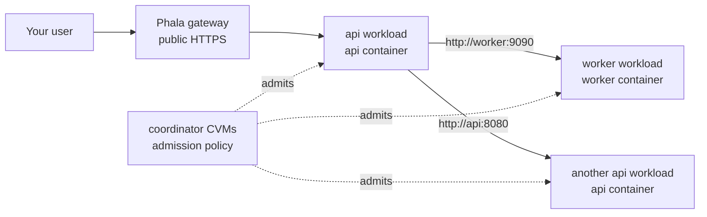

# service-mesh

Build an attested cluster, not just one attested VM.

If you can already deploy one dstack Confidential VM (CVM) on Phala
Cloud, the next question is: how do you run a real application made of
several CVMs, while still knowing that every machine belongs to the
deployment?

This repository is a working template for that problem. It deploys a
multi-CVM application where each node must prove its attestation
evidence before it receives credentials to join the service layer. Once
admitted, workloads call each other by normal service names.

The demo application is HA PostgreSQL plus a small web backend. The
pattern is the important part: define the cluster, deploy it, verify the
running services, then replace the demo workload with your own.

## What You Get

The default deployment is a public web backend plus a private HA
PostgreSQL service. Every workload CVM must pass attestation admission
before it receives Consul and Envoy credentials.


Applications use stable names such as `webdemo`, `postgres-master`, and
`postgres-replica`; they do not need to know which CVM is currently
serving each route.

## Try The Demo

You need:

- a Phala Cloud account,
- a Phala Cloud API key,
- Terraform.

```bash
git clone https://github.com/Dstack-TEE/service-mesh.git
cd service-mesh/clusters/patroni-demo
cp terraform.tfvars.example terraform.tfvars
export PHALA_CLOUD_API_KEY=phak_...
terraform init -upgrade
terraform apply
```

Every node is admitted through attestation before it receives service
credentials.

## Verify It Works

After deployment, Terraform prints `webdemo_url`. Use it from your
laptop:

```bash
WEB=$(terraform output -raw webdemo_url)
echo "$WEB"
curl "$WEB/hello"
```

The URL is built from provider state and has the same shape as other
Phala gateway URLs:

```text
https://<webdemo-app-id>-8080.dstack-pha-prod5.phala.network
```

`/hello` should return one webdemo workload identity:

```text
hello from webdemo-0
```

Now ask that service to call other demo instances through the private
cluster network:

```bash
curl "$WEB/all"
```

The response is JSON. The exact workload names can differ, but the shape
should look like this:

```json
{
  "from": "webdemo-0",
  "results": {
    "hello from webdemo-0": 4,
    "hello from webdemo-1": 4
  },
  "samples": 8
}
```

Seeing more than one workload in `results` proves the important path:

- your request reached the deployed app,
- one workload called another workload by service name,
- the call stayed on the private cluster network,
- the responding workload had been admitted into the cluster.

This HTTP check exercises the public web backend and private web-to-web
mesh path. The database is private; it exposes `postgres-master` and
`postgres-replica` for workloads inside the cluster.

## Demo Inputs

`clusters/patroni-demo/terraform.tfvars.example` contains the default demo
values. Edit the copied `terraform.tfvars` when you want to change
replica counts, cluster name, bootstrap endpoint, or image tags.

The image values must point to public container images that Phala Cloud
can pull. The example uses the release image names; if your deployment
sees a registry authorization error, replace them with public image tags
from your build.

Public gateway URLs are derived from the Phala Terraform provider's
`gateway_base_domain` attribute, so this template does not require a
hardcoded gateway suffix.

## Starter Template

Use `clusters/starter` when you want the smallest custom mesh to copy:
one public API workload group and one private worker workload group.
It deliberately has no database and no Patroni role tags.

```bash
cd service-mesh/clusters/starter
cp terraform.tfvars.example terraform.tfvars
export PHALA_CLOUD_API_KEY=phak_...
terraform init -upgrade
terraform apply

API=$(terraform output -raw api_url)
curl "$API/hello"
curl "$API/worker"
```

`/hello` returns the API instance identity. `/worker` makes the API call
`http://worker:9090/hello` through the private mesh.

## Repository Layout

- `clusters/patroni-demo`: full demo cluster, including its Terraform
  definition and compose files.
- `clusters/starter`: minimal API + worker cluster template.
- `components`: reusable platform components built into the sidecar or
  support images.
- `workloads`: demo workload images used by the Patroni demo.
- `support`: helper services that are useful during bootstrap or local
  operation but are not a cluster definition.
- `docs`: architecture, operations, and design notes.

## Default Demo Topology

This section describes the shipped demo only: a public web backend plus
an HA PostgreSQL database. The custom mesh example later in this README
uses a different topology (`api` + `worker`) so the two examples do not
share service names or workload groups.

The default demo deploys separate workload groups. `webdemo` runs in its
own replica set and is public through the Phala gateway. Postgres runs
in a separate Patroni/Postgres replica set and is private, reached only
by mesh service name.

Inside the default demo cluster, workload code can call these service
names:

```text
http://webdemo:8080
postgres-master:5432
postgres-replica:5432
```

Workloads do not need to know which CVM currently hosts a service. In
the PostgreSQL part of the demo, `postgres-master` follows the current
leader and `postgres-replica` reaches read replicas. After failover,
clients keep using the same names.

## Define Your Own Service Mesh

This section is for replacing the shipped demo with your own workload.
It uses these terms:

- A workload group is one Phala app managed by Terraform. It has one
  compose file and one or more CVM replicas.
- A backend is a real server process in a workload group, such as an API
  server on `127.0.0.1:8080`.
- A route is a stable mesh name that application code dials, such as
  `api:8080` or `worker:9090`.
- A compose hash identifies the compose file that dstack measured for a
  workload group.
- An admission policy row is the Terraform-rendered rule that tells the
  coordinator which workload identity, peer name, and compose hash are
  allowed to join.

To define a custom topology, decide which containers belong in each
workload group and which route names those workloads should use to call
each other.

The following custom example is intentionally different from the default
web-backend-plus-database demo. It has a public API and a private job
worker, with no database routes:



The starter cluster in `clusters/starter/cluster.tf` is a small version
of this shape:

```hcl
locals {
  workload_groups = {
    api = {
      replicas = 2
      compose  = "${path.module}/compose/api.yaml"
      images   = { API_IMAGE = var.api_image }
      secrets  = {}
      backends = {
        api = {
          port                = 8080
          workload            = "api"
          registration        = { owner = "platform", parent = "api" }
          consul_permissions  = {}
        }
      }
      routes = {
        api = { backend = "api", role = null }
      }
    }

    worker = {
      replicas = 5
      compose  = "${path.module}/compose/worker.yaml"
      images   = { WORKER_IMAGE = var.worker_image }
      secrets  = {}
      backends = {
        worker = {
          port                = 9090
          workload            = "worker"
          registration        = { owner = "platform", parent = "worker" }
          consul_permissions  = {}
        }
      }
      routes = {
        worker = { backend = "worker", role = null }
      }
    }
  }
}
```

Each route is a name that application code can dial. Each backend is a
real local server hosted by one workload group. The sidecar gives every
route a service VIP, registers local producer backends in Consul, and
starts an egress Envoy on every workload CVM so calls work even when the
caller does not host the target backend.

Run each application container in its own group's compose file beside
the existing `sidecar` service. For example, `clusters/starter/compose/api.yaml` would
contain:

```yaml
services:
  api:
    image: ghcr.io/you/api@sha256:...
    network_mode: host
    restart: unless-stopped
    entrypoint: ["/run/mesh/exec.sh"]
    command: ["/app/api"]
    volumes:
      - /tmp/dstack-runtime/mesh:/run/mesh:ro
    depends_on:
      sidecar:
        condition: service_healthy
```

`clusters/starter/compose/worker.yaml` would have the same sidecar and a `worker`
service that binds `127.0.0.1:9090`.

After deployment, code in either workload group can call:

```text
http://api:8080
http://worker:9090
```

Use `/run/mesh/exec.sh` as the entrypoint for each application
container that needs mesh service names.

> [!NOTE]
> The sidecar generates route-name resolution files under `/run/mesh`
> from `MESH_ROUTES_JSON`. The helper script installs that resolution
> inside the application container and then `exec`s the command you
> provided.

For a backend port listed in `workload_groups`, avoid binding `0.0.0.0:<port>`.
That also captures the local mesh address for the same port. Bind
`127.0.0.1:<port>` for mesh traffic; if the same service is public
through the Phala gateway, also bind the host interface address. The
demo [`webdemo`](workloads/webdemo/main.go) shows that dual-bind pattern.

## Service Definition Reference

A backend is a real server process in one workload group. The mesh needs
to know who owns that backend's Consul registration:

- `registration.owner = "platform"` means the sidecar owns the Consul
  service registration, health check, tags, and Connect proxy wiring.
  Use it for ordinary HTTP, TCP, or gRPC services whose routing metadata
  is static.
- `registration.owner = "workload"` means the sidecar creates the
  Connect-aware starting point, but workload code later updates runtime
  metadata such as role tags or health checks. Use it when a service
  manager such as Patroni decides which instance is leader or replica.

The custom API/worker example above uses platform-owned backends because
`api` and `worker` are ordinary static services. The default demo
database uses a workload-owned backend because Patroni publishes runtime
role metadata.

| Field | Required | Meaning |
|---|---:|---|
| `replicas` | workload group | Number of CVMs in this workload group. |
| `compose` | workload group | Compose file for this group. Terraform creates one `phala_app` per group. |
| `backends.<name>.port` | backend | Local producer port. The workload should bind `127.0.0.1:<port>` for private mesh traffic. |
| `backends.<name>.workload` | backend | Admission identity suffix, producing `spiffe://<cluster>/<workload>`. |
| `backends.<name>.registration.owner` | backend | `platform` or `workload`. Use `workload` when an adapter updates runtime tags or health checks. |
| `backends.<name>.registration.parent` | backend | Parent Consul service that routes select from. |
| `backends.<name>.consul_permissions` | backend | Extra Consul ACL rights for the backend identity, merged with mesh defaults. |
| `routes.<name>.backend` | route | Backend hosted by the same workload group. Apps dial `${route-name}:${backend-port}`. |
| `routes.<name>.role` | route | Runtime role selector. When set, the route selects service instances tagged with that role, such as `master` or `replica`. |

Plan-time checks enforce the invariants the runtime depends on: route
names are unique, every backend has one parent service and registration
owner, workload groups have at least one slot, peer IDs are unique, route
VIPs are unique, and producer sidecar ports are unique.

### Platform-Owned Services

For a normal service, set `registration.owner = "platform"`. The sidecar
owns the Consul service registration, health check, tags, and Connect
proxy wiring:

```hcl
{
  port               = 8080
  workload           = "api"
  registration       = { owner = "platform", parent = "api" }
  consul_permissions = {}
}
```

This produces a backend named `api`, a route named `api`, and a service
identity `spiffe://<cluster>/api`.

### Default Demo Database Route Pattern

The shipped backend-plus-database demo uses
`registration.owner = "workload"` for Postgres because runtime metadata
belongs to Patroni. The sidecar still creates a Connect-aware stub so
Envoy can start, but `workloads/patroni/entrypoint.sh` updates dynamic metadata
such as role tags and health checks. `postgres-master` and
`postgres-replica` are two routes to one Patroni/Postgres backend:

```hcl
locals {
  workload_groups = {
    postgres = {
      replicas = var.postgres_replicas
      compose  = "${path.module}/compose/postgres.yaml"
      backends = {
        postgres = {
          port         = 5432
          workload     = "postgres"
          registration = { owner = "workload", parent = var.cluster_name }
          consul_permissions = {
            key_prefixes  = ["service/${var.cluster_name}"]
            session_write = true
          }
        }
      }
      routes = {
        "postgres-master"  = { backend = "postgres", role = "master" }
        "postgres-replica" = { backend = "postgres", role = "replica" }
      }
    }
  }
}
```

Both routes share `backend = "postgres"` and select the same parent
service, `var.cluster_name`. Patroni uses Consul for leader election,
and `workloads/patroni/entrypoint.sh` runs the role-watcher that publishes the
current `master` or `replica` tag. The Consul resolver for each route
selects the matching tag, so clients keep dialing
`postgres-master:5432` and `postgres-replica:5432` across failovers.

## What Is Verified

When a workload CVM joins, it submits dstack evidence to the coordinator:
the part of the cluster that decides whether a node can receive service
identity. The coordinator checks that evidence against the policy
generated from the Terraform deployment definition.

The policy checks include:

- the TEE quote, which proves the CVM is running under the expected
  trusted execution environment,
- the claimed workload identity,
- the measured compose hash, which identifies the app definition dstack
  measured,
- the KMS identity, which identifies the key service used by the CVM,
- the claimed peer name.

If the evidence matches, the workload receives scoped service identity.
If it does not match, it cannot join the service layer.

See [`docs/attestation.md`](docs/attestation.md) for the exact evidence format and
verification flow.

## How It Works

The first-run path hides the internals, but the implementation uses
standard infrastructure:

- Terraform for deployment and policy rendering,
- Consul for membership and service catalog,
- Envoy for service-to-service mutual TLS,
- Patroni for PostgreSQL failover in the demo workload,
- dstack attestation and `dstack-verifier` for evidence checks,
- a small peer transport so CVMs can talk privately across the provider
  network.

Read [`docs/architecture.md`](docs/architecture.md) when you want the lower-level
design.

## Development

Validate Terraform:

```bash
terraform -chdir=clusters/patroni-demo init -upgrade
terraform -chdir=clusters/patroni-demo validate
terraform -chdir=clusters/starter init -upgrade
terraform -chdir=clusters/starter validate
```

Run local Go tests:

```bash
(cd components/admission-broker && go test ./...)
(cd components/signaling && go test ./...)
(cd workloads/webdemo && go test ./...)
```

Some modules use Go 1.24. Run them through Docker if your host Go is
older:

```bash
docker run --rm -v "$PWD:/src" -w /src/components/admission-client golang:1.24 go test ./...
docker run --rm -v "$PWD:/src" -w /src/components/bootstrap-secrets golang:1.24 go test ./...
docker run --rm -v "$PWD:/src" -w /src/components/mesh-conn golang:1.24 go test ./...
```

Build the sidecar image:

```bash
docker build -t service-mesh-mesh-sidecar-check -f components/mesh-sidecar/Dockerfile .
```

## More Docs

- [`docs/attestation.md`](docs/attestation.md): trust flow and evidence checks.
- [`docs/architecture.md`](docs/architecture.md): lower-level network and service
  design.
- [`docs/failover.md`](docs/failover.md): failover tests and measured recovery
  times.
- [`docs/robustness.md`](docs/robustness.md): failure modes and mitigations.
- [`docs/publishing.md`](docs/publishing.md): image publishing and provenance.
- [`docs/progress.md`](docs/progress.md): current status and remaining work.
- [`docs/design/README.md`](docs/design/README.md): design notes and handoff
  docs for open or historical implementation work.

## Current Limits

- The public connection-bootstrap endpoint is intended for demos and
  development. Production deployments should use a managed or
  tenant-owned endpoint.
- The current Terraform provider can add or remove instances without
  disturbing the rest of the cluster, but in-place workload updates are
  still waiting on cloud revision rollout support.
- Cluster-wide PostgreSQL and service-layer bootstrap secrets are still
  generated by Terraform and stored in the Terraform state file. The
  planned replacement is secret generation and distribution inside
  attested CVMs.
- Broker-issued service tokens are currently long-lived. Short TTLs need
  explicit renewal and reload paths.

## License

Apache-2.0. See [`LICENSE`](LICENSE).
